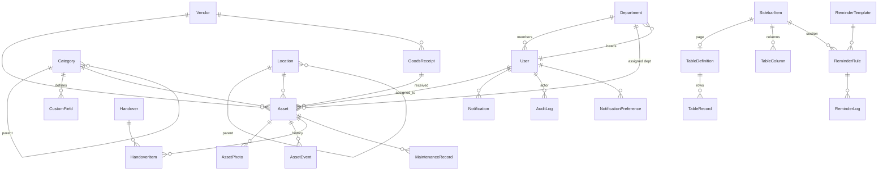

# Architecture

## Runtime topology

```
                ┌──────────────────────────── docker compose ────────────────────────────┐
 Browser/PWA ──▶│ nginx :2025 (static SPA, gzip, CSP, rate limits, /admin/ allowlist)    │
                │   ├── /                → Vue SPA (built assets under /_app/)            │
                │   ├── /api/, /admin/, /static/ ─┐                                       │
                │   ├── /ws/  ────────────────────┴─▶ api :2000                           │
                │   │                                Gunicorn + Uvicorn workers (ASGI):   │
                │   │                                Django + DRF + Channels, one port    │
                │   └── /media/          → public media volume (photos, avatars)          │
                │                                                                        │
                │ worker (Celery)  ── alerts, reminder delivery, realtime broadcasts     │
                │ beat   (Celery beat) ── daily alert scans, reminder scan every 5 min   │
                │ postgres  ── primary datastore                                         │
                │ redis     ── db0 Celery broker, db1 cache, db2 Channels layer          │
                └────────────────────────────────────────────────────────────────────────┘
```

Realtime groups: `user_<id>` (personal notifications), `dashboard` (managers: live stats), `broadcast` (everyone: `sidebar.update`, `dashboard.layout`, `table.columns`).

## Folder structure

```
asset_management_tools/
├── backend/
│   ├── Dockerfile                  # multi-stage: builder (wheels) → slim runtime, non-root
│   ├── entrypoint.sh               # secret key, waits for DB, migrate + bootstrap (api only)
│   ├── manage.py
│   ├── pyproject.toml              # ruff + pytest config
│   ├── requirements/{base,dev}.in  # loose specs
│   ├── requirements/{base,dev}.txt # pinned lockfiles (uv pip compile)
│   ├── config/
│   │   ├── settings/{base,dev,prod,test}.py
│   │   ├── urls.py  asgi.py  wsgi.py  celery.py
│   └── apps/
│       ├── core/          # base models, counters, RBAC permissions, health, middleware, pdf, utils
│       ├── accounts/      # User (roles), Department, JWT cookie auth
│       ├── assets/        # Category, CustomField, Location, Vendor, Asset, AssetPhoto, AssetEvent,
│       │                  # QR/barcode, labels, CSV/XLSX import & export
│       ├── workflows/     # GoodsReceipt (inward), Handover + HandoverItem (issue/return/transfer),
│       │                  # digital sign-off, PDF receipts
│       ├── maintenance/   # MaintenanceRecord, repair status flow
│       ├── notifications/ # Notification, WebSocket consumer, Celery alert tasks
│       ├── audit/         # AuditLog + recording helpers
│       ├── dashboard/     # DashboardWidget, data-source registry, cached stats, realtime signals
│       ├── navigation/    # SidebarItem (menu + colors), TableDefinition, TableRecord, TableColumn,
│       │                  # per-user table prefs, table registry, bulk/export mixin
│       └── reminders/     # channels, rules, templates, logs, preferences; engine, providers, tasks
│   └── tests/             # pytest + factory_boy (unit, API, WebSocket)
├── frontend/
│   ├── Dockerfile                  # multi-stage: node build → nginx runtime (edge proxy)
│   ├── vite.config.js  index.html  package.json
│   └── src/
│       ├── api/           # axios client (token refresh queue) + endpoint modules
│       ├── stores/        # Pinia: auth, theme, notifications, sidebar, ui (toasts, confirm dialog)
│       ├── services/      # realtime WebSocket client (auth handshake, backoff, heartbeat)
│       ├── router/        # routes + auth/role guards
│       ├── layouts/       # AppLayout (sidebar / mobile bottom nav), AuthLayout
│       ├── components/    # ui/* (ConfirmDialog, AppModal…), table/*, reminders/*, charts/*, assets/*, workflows/*
│       ├── composables/   # useList, useTableConfig, useTableNames, modalStack, usePermissions …
│       ├── views/         # dashboard, assets, scan, receiving, handovers, maintenance,
│       │                  # catalog, people, records (custom tables), reminders, settings, audit, profile
│       └── utils/
├── nginx/nginx.conf  conf.d/  snippets/    # reverse proxy, brotli/gzip, security headers, admin allowlist
├── docker-compose.yml                     # production-like stack
├── docker-compose.dev.yml                 # override: exposed ports, debug logs, MailHog
├── .github/workflows/ci.yml               # lint, tests (PG+Redis services), build images
├── .env.example
└── README.md
```

## Database schema



| Table | Key columns |
|---|---|
| **accounts_department** | id, name (uq), code (uq), description, head_id→user, is_active, created_at, updated_at |
| **accounts_user** | id, email (uq, login), first/last_name, role (`admin`/`manager`/`employee`), department_id, employee_id (uq, null), job_title, phone, avatar, is_active, is_staff, password, last_login |
| **core_counter** | key (pk), value — gap-free, row-locked sequences for `AST-`, `GRN-`, `HND-` references |
| **assets_category** | id, name, slug (uq), parent_id (self), icon, color, description, is_active |
| **assets_customfield** | id, category_id, key, label, field_type (`text`/`number`/`date`/`boolean`/`select`), options (json), required, order — uq(category, key) |
| **assets_location** | id, name, code (uq), parent_id (self), address |
| **assets_vendor** | id, name (uq), contact_name, email, phone, website, address |
| **assets_asset** | id, asset_tag (uq), name, description, category_id, status (`in_stock`/`assigned`/`in_repair`/`retired`/`lost`), condition, serial_number (uq, null), model, manufacturer, vendor_id, receipt_id, purchase_date, purchase_cost, currency, invoice_number, po_number, warranty_expiry, maintenance_interval_days, next_maintenance_date, location_id, assigned_to_id, department_id, assigned_at, custom_data (jsonb), notes, created_by_id, timestamps — indexes on status, warranty_expiry, next_maintenance_date, (assigned_to, status) |
| **assets_assetphoto** | id, asset_id, image, caption, is_primary, uploaded_by_id, created_at |
| **assets_assetevent** | id, asset_id, event_type, from/to_status, from/to_user_id, from/to_department_id, from/to_location_id, actor_id, handover_id, receipt_id, maintenance_id, notes, metadata (jsonb), created_at — immutable history log |
| **workflows_goodsreceipt** | id, reference (uq), vendor_id, received_date, invoice_number, po_number, location_id, received_by_id, notes, signature (private file), signed_name, signed_at, custom_data (jsonb) |
| **workflows_handover** | id, reference (uq), type (`issue`/`return`/`transfer`), status (`pending`/`completed`/`cancelled`), from_user_id, from_department_id, to_user_id, to_department_id, to_location_id, signer_id, created_by_id, expected_return_date, notes, issuer_signature, signature (private files), signed_name, signed_at, signed_ip, completed_at, cancelled_at, cancel_reason, custom_data (jsonb) |
| **workflows_handoveritem** | id, handover_id, asset_id (PROTECT), condition, notes — uq(handover, asset) |
| **maintenance_maintenancerecord** | id, asset_id, kind, title, description, status (`scheduled`/`in_progress`/`completed`/`cancelled`), scheduled_date, started_at, completed_date, cost, vendor_id, technician, previous_asset_status, created_by_id, notes, custom_data (jsonb) |
| **notifications_notification** | id, recipient_id, category, level, title, message, link, data (jsonb), dedupe_key, is_read, read_at, created_at — uq(recipient, dedupe_key) |
| **navigation_sidebaritem** | id, name, item_type (`page`/`link`/`group`/`divider`), icon, route, url, open_in_new_tab, parent_id (self, groups only, ≤3 levels), order, visible_roles (jsonb), is_active, color, icon_color, active_color (hex), gradient, glow, table (table-definition key), timestamps |
| **navigation_tablecolumn** | id, sidebar_item_id, name (header label), key, column_type (`auto_number`/`text`/`number`/`date`/`boolean`/`select`/`user`/`status`/`file`), options (jsonb), width, order, is_visible, is_required, is_searchable, is_sortable, is_builtin, visible_roles (jsonb), timestamps — uq(sidebar_item, key) |
| **navigation_tablepreference** | id, user_id, sidebar_item_id, hidden (jsonb), shown (jsonb), updated_at — uq(user, sidebar_item) |
| **navigation_tabledefinition** | id, sidebar_item_id (1:1), source (built-in key or `custom`), slug (uq), name (uq, case-insensitive), singular, icon, description, timestamps |
| **navigation_tablerecord** | id, definition_id (null when its table was deleted), custom_data (jsonb), is_archived, archived_from, created_by_id, timestamps |
| **reminders_channelconfig** | singleton: email/sms/in_app_enabled, sender_name, sms_provider, sms_sender_id, daily_cap, email_per_minute, sms_per_minute (no secrets) |
| **reminders_remindertemplate** | id, name (uq), subject, body, sms_text (≤160), created_by_id, timestamps |
| **reminders_reminderrule** | id, section_id→sidebar item, name, trigger, trigger_config (jsonb), channels (jsonb), recipients (jsonb), schedule (jsonb), template_id (PROTECT), attachments (jsonb), is_active, last_run_at, next_run_at, created_by_id, timestamps |
| **reminders_reminderlog** | id, rule_id, rule_name, recipient_id, recipient_address, channel, status (`queued`/`sent`/`failed`/`skipped`), subject, message, html, object_ref, link, error, provider_message_id, attachments (jsonb), dedupe_key (uq), attempts, is_test, deliver_after, sent_at, created_at |
| **reminders_notificationpreference** | id, user_id, section_id (null = all sections), email_enabled, sms_enabled |
| **reminders_contactsettings** | user (1:1), verified_phone, phone code hash/expiry/attempts, quiet_start, quiet_end, timezone |
| **dashboard_dashboardwidget** | id, title, widget_type (`stat`/`chart`/`table`), data_source (registry key), chart_type, size (`sm`/`md`/`lg`/`full`), position, visible_roles (jsonb), config (jsonb: tone, icon), is_active, timestamps |
| **audit_auditlog** | id, actor_id, action, model, object_id, object_repr, changes (jsonb), ip_address, user_agent, request_id, created_at — indexes on (model, object_id), created_at |

## Domain rules

**Asset status machine** (manual changes via `POST /assets/{id}/change-status/`; `assigned` is otherwise only set by handovers):

| target | allowed when |
|---|---|
| `in_stock` | asset has no holder (holders leave via a *return* handover) |
| `assigned` | asset has a holder (restoring after repair / found) |
| `in_repair`, `lost` | asset is not retired |
| `retired` | asset has no holder |
| from `retired` | only back to `in_stock` |

**Handovers**: `issue` needs `in_stock` assets; `transfer` and `return` need assets held by a single holder. A handover is created `pending`, the designated signer (employee, or a manager signing in person) draws a signature, and completion applies all asset changes atomically under row locks, writes `AssetEvent`s, notifies parties and broadcasts a dashboard update. PDF receipts are rendered on demand.

**Roles**

| capability | Admin | Manager | Employee |
|---|---|---|---|
| Sidebar, dashboard, tables & columns configuration, reminder channels, audit log | ✅ | — | — |
| Reminder rules & templates | ✅ all | ✅ own sections | — |
| Bulk delete / status / export | ✅ | ✅ | — |
| Users, departments | ✅ | read | — |
| Assets, catalog, receiving, handovers, maintenance, import/export | ✅ | ✅ | read own assets |
| Own reminder preferences, sign handovers addressed to them, notifications, profile | ✅ | ✅ | ✅ |

**Dashboard data sources** declare a scope: `org` sources (totals, charts, activity) may only be shown to admins/managers — enforced when a widget is saved and again when data is served; `personal` sources (my assets, awaiting signature…) are available to every role.

**Configurable tables**: `navigation/tables.py` defines each table's built-in columns (row key, default label/type, ORM search paths, sort expression, export getter). `TableColumn` rows attach that config to a sidebar page; custom columns store values in the record's `custom_data`. A viewset mixin returns the effective columns with the rows and applies config-driven search, ordering, `cf.<key>` filters and export; `TablePreference` holds each user's show/hide overrides.

**Table definitions**: each table page has one `TableDefinition` that holds its display names. Built-in tables map to their model through the registry; `custom` tables store rows as `TableRecord`s. Deleting a definition is refused while it still has rows (`delete-check` explains why). `bulk-archive` and `bulk-move` clear a table first; archived rows keep the old table name in `archived_from`.

**Bulk actions**: `ConfigurableTableMixin` adds `bulk-delete` (one transaction; per-row rules return skip reasons instead of failing the batch) and `export-table` (scope `all`/`filtered`/`selected`, CSV with BOM, XLSX, PDF; formula cells escaped) to every list viewset. Admin and Manager only.

**Reminders**: beat runs `scan_reminder_rules` every 5 minutes. For each due rule the engine finds matching events for its trigger, works out the recipients, drops opt-outs, unverified phones and quiet hours, builds the attachments (files over `REMINDER_ATTACHMENT_MAX_MB` become signed links that expire) and queues one `ReminderLog` per recipient and channel. The unique `dedupe_key` makes repeats impossible. `deliver_log` holds a per-message lock, enforces per-minute rate limits and the daily cap, sends through the provider, and retries with backoff (30 s × 2ⁿ, at most 5 attempts); a final failure notifies admins.

**Overlays**: `modalStack` assigns z-index by stacking depth, so the topmost layer gets Esc and the focus trap, and body scroll stays locked until the last layer closes. `ConfirmDialog` is teleported to `<body>` at z 200, above every modal (60+), with toasts above both.

**First start**: `entrypoint.sh` creates a secret key if none is set and stores it in the private volume. `manage.py bootstrap` (idempotent) re-seeds the menu, definitions, columns and widgets, then creates the first superuser from `ADMIN_EMAIL`/`ADMIN_PASSWORD`, generating and printing a password if none is set.

**Django admin** is kept for break-glass use: a custom `AdminSite` admits active superusers only, and nginx restricts `/admin/` to an IP allowlist (optional basic auth).

**Security**: short-lived JWT access token kept in memory; refresh token in an `HttpOnly; Secure; SameSite=Strict` cookie scoped to `/api/auth/`, rotated and blacklisted on use; WebSocket authenticates with a first-message token (no tokens in URLs/logs); signatures stored in private storage never exposed by nginx.
